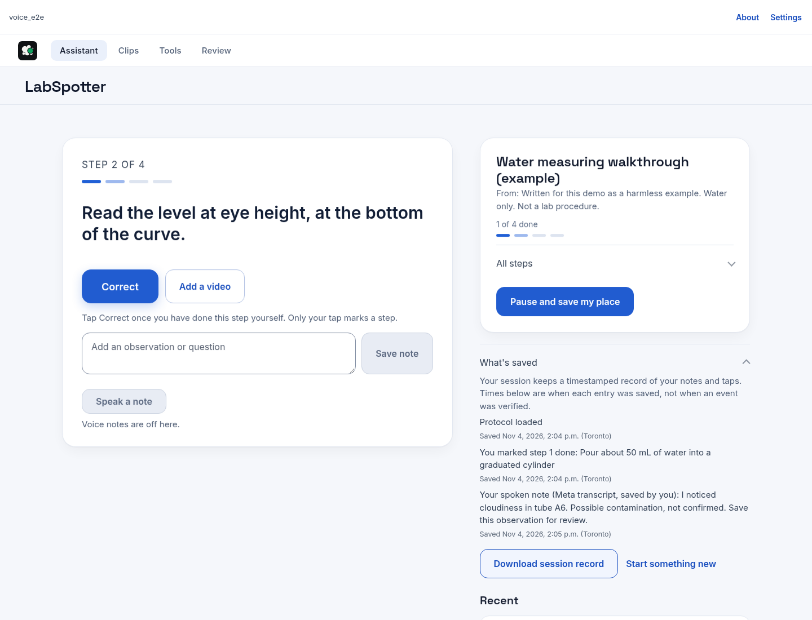
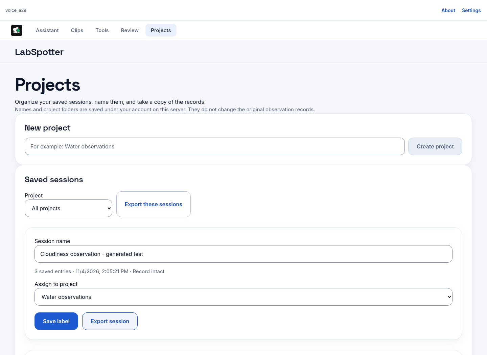

<p align="center"></p>

# LabSpotter

**Keep your place. Keep the evidence.**

A lab session is more than a predicted action. It is the guide you were following, the observation you made, the step you confirmed, and the place you need to return to after an interruption.

LabSpotter brings that record together in a responsive web app: short-video action suggestions, written guides, editable observation notes, and saved sessions you can reopen and export.

Built by Thomas Kim for the Meta Global AI Developer Hackathon. Powered by Meta V-JEPA 2, with optional Meta speech transcription and session recaps. The app implements its own accounts, storage, and session recovery.

[Product guide](docs/PRODUCT_GUIDE.md) · [Demo walkthrough](DEMO.md) · [Build evidence](docs/BUILD_EVIDENCE.md) · [Technical record](docs/DEVELOPMENT_NOTES.md)



*Actual local browser capture: written guide, user-confirmed step, and a saved Meta-transcribed test observation. Generated test audio; save times are not verified event times.*

## From an observation to a record

1. **Start with a guide or video.** Follow a written guide, or add a short clip for an eight-action model suggestion.
2. **Keep your judgment separate.** Agree with or change the suggested action. Only your own tap marks a guide step done.
3. **Capture what you noticed.** Type a note, or use Meta transcription when the operator has enabled voice. Edit the draft before saving.
4. **Pause without losing your place.** Reopen server-saved entries and your confirmed guide steps. In account mode, the same account can restore them in another browser on the same site.
5. **Organize and export.** Name saved sessions, assign them to projects, filter the list, and export one session or the sessions in view as JSON.

A saved time means when an entry was saved, not proof of when an event happened. Restoring a record does not establish the bench's current condition.

## What makes it work

### Meta video features, a trained lab-action head

The frozen V-JEPA 2 encoder turns a short video into features. A StandardScaler + logistic-regression classifier trained for eight lab-action classes turns those features into a reviewable suggestion. The app preserves that model suggestion separately from a person's later confirmation or correction.

Classes: Add, Analytical Measurement, Collect Layer, Measure Liquid, Measure Solid, Phase Separation, Stir, and No action.

### Notes with a traceable source

Typed observations and user-saved Meta transcripts appear in the session log with their source and server save time. A transcript starts as an editable draft, not an automatic finding. The working voice demonstration used generated test audio sent through the real Meta transcription route; it was not a physical-phone microphone test.

### Pause, restore, and continue

The session store keeps notes, model claims, and user actions together. Continuing a session rechecks the saved record's integrity before restoring it. Account mode isolates records by account. Theme preferences and Review demo marks remain browser-local.

### Projects that keep the record intact

Name a saved session, create a project, and assign the session to it. Labels and project membership are account/server-scoped metadata, separate from the original observation checkpoints. Export a single session or the filtered sessions without rewriting the evidence.



[Dark phone-width Projects capture](docs/images/4-projects-phone.png) · [Dark phone-width observation capture](docs/images/2-observation-phone.png)

*Actual local browser capture. Projects and labels persisted into a fresh browser context on the same account/server; the test export contained one selected session.*

### A focused interface

Light and dark themes, desktop and phone-width layouts, a guide beside the active work, and a saved-entry log. The camera flow captures browser video segments and shows when segments are skipped; it is not continuous surveillance or proof that every action was captured.

## The current build

The video-to-suggestion, saved-session recovery, session labels, Projects page, JSON export, account flows, and responsive interface have been exercised in development. The real Meta transcription route returned an editable transcript draft that was saved, and the same entries were restored in a fresh browser context. These are separate checks with different scopes, not a claim that every component has run together on a deployed service.

**Model measurement:** the selected `frozen384` head scored **0.512 balanced accuracy on 229 official validation clips from 5 sources, across 8 classes**. Those clips have since been used for development, so this is not a blind test. Balanced accuracy is not raw accuracy. The 75% raw-accuracy target is not met. Successful demo clips illustrate the workflow, not overall accuracy.

The app suggests actions. It does not verify protocol completion, diagnose contamination, or provide a safety clearance. See [the evidence and scope notes](docs/BUILD_EVIDENCE.md).

## Run it locally

You need Python 3.10+, `ffmpeg` on PATH, and enough memory for the encoder (about 3 GB in the recorded development environment). The first real analysis downloads about 1.5 GB of V-JEPA 2 weights. Node 22.18+ is needed for GUI unit tests; Node and npm are needed to rebuild the frontend.

```bash
git clone https://github.com/nxtkim-1/labspotter-public.git
cd labspotter-public
bash ./run_local.sh --check   # checks only; installs and starts nothing
bash ./run_local.sh           # installs the CPU dependencies and starts the server
```

Open `http://127.0.0.1:8765/`. Follow the launcher's instructions to read your local start code and enter it in the app. Do not share that code or include it in screenshots.

The helper uses a local virtual environment and version pins; it is not a complete lockfile or a deployment tool. Historical environment-specific launch results are kept in [the runbook](docs/RUNBOOK.md). macOS/Windows hosting and physical-phone capture are not certified by the responsive browser checks.

To rebuild the frontend:

```bash
cd gui
npm ci
npm run build
```

For direct Python launch, environment variables, API wiring, and recovery, see [the runbook](docs/RUNBOOK.md) and [wiring notes](WIRING.md). Their older sections are dated development records; the current product scope is summarized here and in the product guide.

## Test it

```bash
bash ./run_all_tests.sh
```

The runner separates Python checks, GUI unit checks, and browser checks against a **stub backend**. Read any `SKIPPED` lines: a summary pass is not proof that every optional browser check ran. Real-encoder checks are separate and require the model dependencies and explicit opt-in. [Build evidence](docs/BUILD_EVIDENCE.md) explains what each check establishes.

## Data and optional Meta features

- Video-action inference runs on the machine running `server.py`. With a hosted copy, uploaded video is processed on that host, not on your phone.
- The trained action-suggestion path does not send video to Meta's hosted API. Optional Meta quick-look, transcription, or recap features can send their relevant clip, audio, or saved text to Meta when enabled.
- Meta features are operator-controlled and off without the required configuration. Account-mode agent routes remain disabled. Voice has a separate invite-only enablement path with server-side credentials and per-account/global lifetime limits.
- Do not use sensitive footage or notes in an experimental Meta-enabled deployment. This repository is source code, not a claim that a public service is deployed.

## Next

- Stronger action recognition, evaluated on a fresh source-separated holdout.
- A reproducible install and measured performance under load.
- Physical-phone microphone and camera checks, plus broader host-platform tests.
- Richer project workflows and record reuse, beyond the current labels, grouping, and JSON export.

Working features and planned work stay separate. The technical history is retained rather than replaced by the demo narrative.

## Explore the source

| Area | Files |
| --- | --- |
| Web interface | [`gui/src/`](gui/src/) |
| HTTP server and accounts | [`server.py`](server.py), [`auth.py`](auth.py) |
| Video-action pipeline | [`chain/`](chain/), [`heads/active.json`](heads/active.json) |
| Saved-session engine | [`engine/`](engine/) |
| Voice controls and limits | [`voice_gate.py`](voice_gate.py), [`voice_allowance.py`](voice_allowance.py) |
| Development measurements | [`docs/VIDEO_ACTION_CHAIN.md`](docs/VIDEO_ACTION_CHAIN.md), [`DEV_RESULTS_1427.md`](DEV_RESULTS_1427.md) |
| Runtime and regression checks | [`tests/`](tests/), [`gui/`](gui/) |

## Licence and credits

Code: [MIT](LICENSE). The included demo clips are IBM Research Zurich lab-action clips distributed under CDLA-Permissive-2.0. Demo footage is third-party material, not footage of Thomas's own experiment. Fonts, models, data, and packages retain their own terms. See [third-party notices](THIRD-PARTY-NOTICES.txt) and [font provenance](docs/FONT-PROVENANCE.md).
